# EduX — mobil ilova (Android, iPhone va iPad)

Flutter'da yozilgan to'liq native ilova (WebView emas). EduX serveri bilan o'sha API orqali ishlaydi, o'zbek, rus va ingliz tillarida.

## Yuklab olish

Har `main` push'dan keyin GitHub Actions ilovani yig'adi va **Releases → latest** ga qo'yadi:
ko'pchilik telefonlar uchun `app-arm64-v8a-release.apk`, eski telefonlar uchun `app-armeabi-v7a-release.apk`.
iPhone va iPad uchun o'sha yerda `EduX-iOS-unsigned.ipa` (imzosiz — App Store'ga chiqqunicha sinov uchun: AltStore/Sideloadly
yoki o'z Apple sertifikatingiz bilan imzolab o'rnatiladi; quyida «iPhone va iPad: App Store'ga chiqarish»).

Actions sozlamalari (Settings → Secrets and variables → Actions):

| Nomi | Turi | Nima uchun |
|---|---|---|
| `EDUX_SERVER` | Variable | Ilova ulanadigan server (bo'lmasa `https://edux.kuchkarov.uz`) |
| `GOOGLE_SERVICES_JSON` | Secret | Firebase `google-services.json` matni — push-bildirishnomalar uchun |
| `ANDROID_KEYSTORE_BASE64`, `ANDROID_KEYSTORE_PASSWORD`, `ANDROID_KEY_ALIAS`, `ANDROID_KEY_PASSWORD` | Secret | Play Market imzosi (bo'lmasa sinov kaliti) |

Play Market uchun `.aab`: imzo kaliti secrets'da bo'lsa, har `main` yig'ishida imzolangan `edux-<versiya>-<yig'ish>.aab`
ham **Releases → latest** ga qo'shiladi (kalitsiz — faqat Actions → Build → «Run workflow», sinov kaliti bilan, Play qabul qilmaydi).

### Google Play'ga yuklash

1. Kalit: `keytool -genkey -v -keystore edux.jks -keyalg RSA -keysize 2048 -validity 10000 -alias edux`;
   secrets: `ANDROID_KEYSTORE_BASE64` (`base64 -w0 edux.jks`), `ANDROID_KEYSTORE_PASSWORD`, `ANDROID_KEY_ALIAS`, `ANDROID_KEY_PASSWORD`.
   Kalit faylini va parolni xavfsiz joyda saqlang — yo'qolsa ilovani yangilab bo'lmaydi.
2. [Play Console](https://play.google.com/console) → ilova yaratish (paket nomi `uz.edux.edux`) → **Play App Signing** yoqilgan holda
   Testing → Internal testing → Create release → `.aab` ni yuklang (versionCode = yig'ish raqami, har safar o'sadi).
3. Store listing (tavsif, skrinshotlar, ikonka 512×512), Data safety, Content rating, Privacy policy havolasi
   (`<server>/privacy`) to'ldirilgach — Production'ga chiqarish.

**iPhone / iPad / App Store:** Apple Developer Program hisobi ochilgach faqat GitHub secrets qo'shiladi — CI o'zi imzolaydi va
TestFlight'ga yuklaydi (pastda «iPhone va iPad: App Store'ga chiqarish»).

## iPhone va iPad: App Store'ga chiqarish

Ilova tayyor: iPhone va iPad (bitta ilova, `TARGETED_DEVICE_FAMILY = 1,2`), Bundle ID **`uz.edux.edux`**, minimal iOS 15.0.
CI har yig'ishda imzosiz `.ipa` chiqaradi; imzo kalitlari secrets'ga qo'shilsa — imzolangan `.ipa` va TestFlight avtomatik.

1. **Apple Developer hisobi** — [developer.apple.com/programs](https://developer.apple.com/programs/) (yiliga $99; tashkilot
   nomidan bo'lsa D-U-N-S raqami kerak, jismoniy shaxs uchun — shaxsiy hisob). Tasdiqlanishi 1–2 kun.
2. **Bundle ID**: Certificates, Identifiers & Profiles → Identifiers → «+» → App IDs → `uz.edux.edux`, Capabilities'da
   **Push Notifications** belgilansin.
3. **Sertifikat** (Apple Distribution): Mac'da Keychain Access → Certificate Assistant → «Request a Certificate From a
   Certificate Authority» (CSR) → developer.apple.com → Certificates → «+» → Apple Distribution → CSR yuklanadi → `.cer`
   yuklab olinib ikki marta bosiladi → Keychain'da sertifikat + kalitni tanlab **Export** → `.p12` (parol bilan).
   Mac bo'lmasa: `openssl req -new -newkey rsa:2048 -nodes -keyout edux.key -out edux.csr -subj "/CN=EduX"`, so'ng
   `openssl x509 -inform der -in distribution.cer -out edux.pem` va
   `openssl pkcs12 -export -inkey edux.key -in edux.pem -out edux.p12 -legacy`.
4. **Provisioning profili**: Profiles → «+» → **App Store Connect** → App ID `uz.edux.edux` → 3-qadamdagi sertifikat →
   nom (masalan «EduX App Store») → `.mobileprovision` yuklab olinadi.
5. **App Store Connect API kaliti** (TestFlight'ga yuklash uchun): [appstoreconnect.apple.com](https://appstoreconnect.apple.com)
   → Users and Access → Integrations → App Store Connect API → «+» (Access: App Manager) → `AuthKey_XXXX.p8` (bir marta
   yuklanadi), **Key ID** va **Issuer ID** yozib olinadi.
6. **App Store Connect'da ilova**: Apps → «+» → New App → iOS, nom «EduX», asosiy til, Bundle ID `uz.edux.edux`, SKU `edux`.
7. **GitHub secrets** (repo → Settings → Secrets and variables → Actions):

   | Secret | Qiymat |
   |---|---|
   | `IOS_P12_BASE64` | `base64 -i edux.p12` (macOS) yoki `base64 -w0 edux.p12` (Linux) |
   | `IOS_P12_PASSWORD` | `.p12` paroli |
   | `IOS_PROVISION_BASE64` | `base64 -w0 EduX_App_Store.mobileprovision` |
   | `APPSTORE_API_KEY_ID`, `APPSTORE_ISSUER_ID` | 5-qadamdagi Key ID va Issuer ID |
   | `APPSTORE_API_KEY_BASE64` | `base64 -w0 AuthKey_XXXX.p8` |
   | `GOOGLE_SERVICE_INFO_PLIST` | (ixtiyoriy, push) Firebase → Project settings → iOS ilova `uz.edux.edux` → `GoogleService-Info.plist` matni; Firebase'ga APNs Auth Key (`.p8`, Keys → «+» → Apple Push Notifications service) ham yuklanadi |

   Shundan keyin `main` ga har push'da (yoki Actions → Build → «Run workflow») `ios` job: imzolangan `.ipa`
   (`edux-ios-appstore` artefakti) va **TestFlight'ga yuklash** (yig'ish raqami = Actions run raqami, har safar o'sadi).
   Secrets bo'lmasa bu qadamlar o'tkazib yuboriladi — yig'ish yiqilmaydi.
8. **TestFlight**: App Store Connect → ilova → TestFlight — yig'ish 10–30 daqiqada paydo bo'ladi («Missing Compliance»
   so'ralmaydi: `ITSAppUsesNonExemptEncryption = false`). Internal Testing guruhiga jamoa qo'shiladi; tashqi sinovchilar
   uchun — External Testing (Apple ko'rigi ~1 kun).
9. **App Store sahifasi**: nomi, subtitle, tavsif (uz/ru/en), kalit so'zlar, Support URL (`<server>/help`), Privacy Policy
   URL (`<server>/privacy`), toifa (Education), yosh reytingi (4+), App Privacy (telefon, ism, foydalanish ma'lumotlari —
   «App Functionality»). **Skrinshotlar**: iPhone 6.7" (1290×2796) — `docs/screenshots/ios/`, iPad 12.9" (2048×2732) —
   `docs/screenshots/ipad/`. Ko'rib chiqish uchun demo hisob (telefon va parol) «App Review Information» ga yoziladi.
   So'ng TestFlight'dagi yig'ishni tanlab **Submit for Review** (odatda 1–3 kun).

## Kompyuter ilovasi

Windows, macOS va Linux uchun EduX ilovasi alohida repozitoriyda: [Azamat4588/edux-desktop](https://github.com/Azamat4588/edux-desktop)
(Tauri; serverning veb ilovasini o'z oynasida ochadi — barcha rollar uchun). O'rnatuvchilar o'zgarmas havolalarda:
`…/edux-desktop/releases/download/desktop-latest/EduX-Setup-x64.exe`, `EduX-x64.msi`, `EduX-macOS-universal.dmg`,
`EduX-linux-x86_64.AppImage`, `EduX-linux-amd64.deb`.

## Skrinshotlar

iPhone 6.7" va iPad 12.9" (App Store o'lchamlari, yorug' va tungi — `docs/screenshots/ios/`, `docs/screenshots/ipad/`):

| | | |
|---|---|---|
| 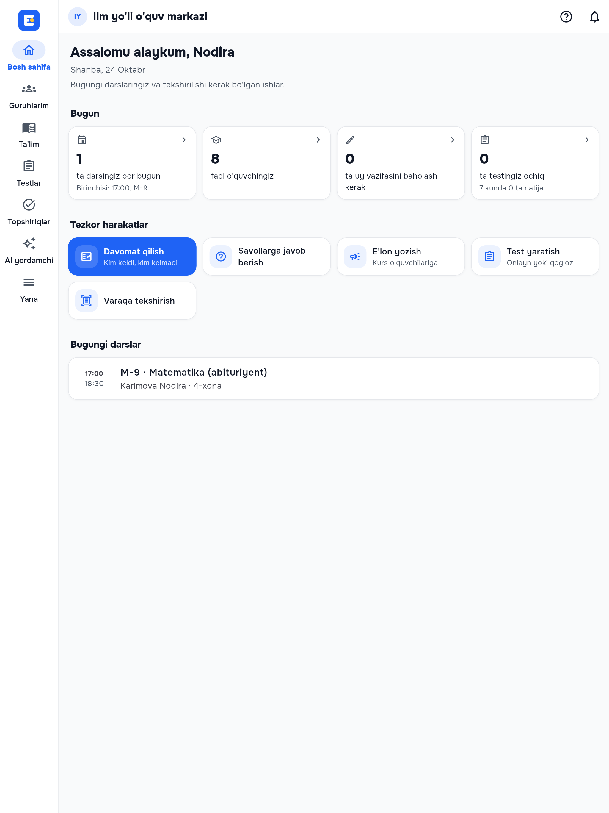 | 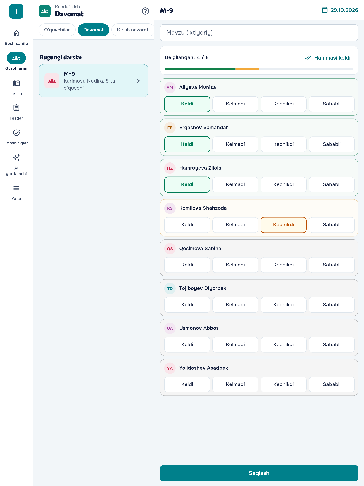 | 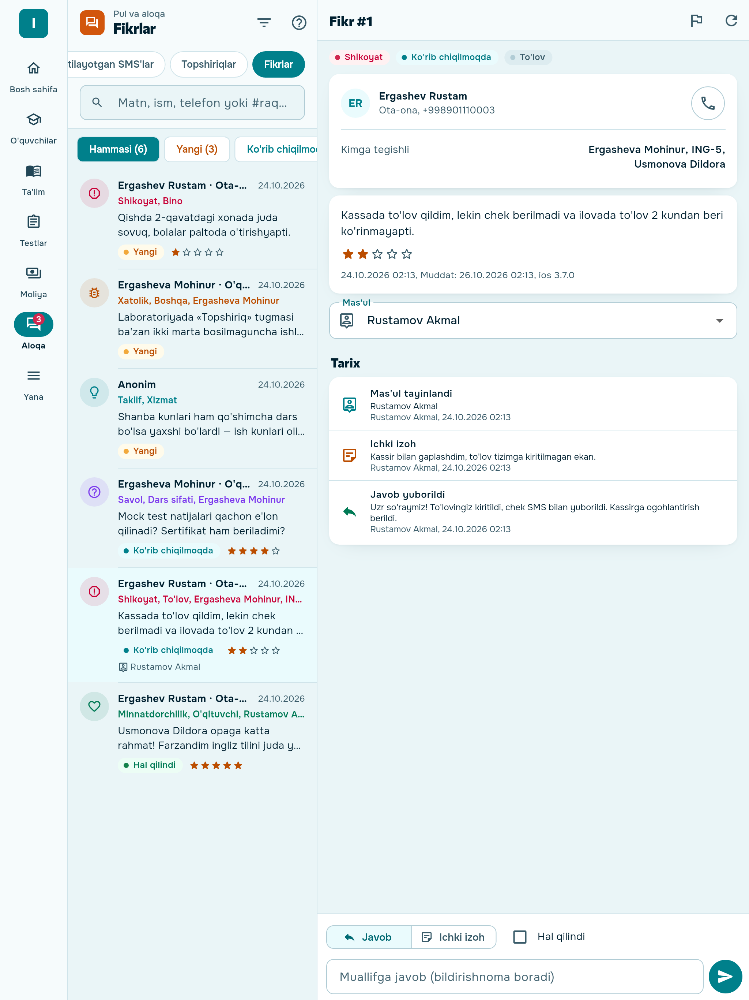 |
| 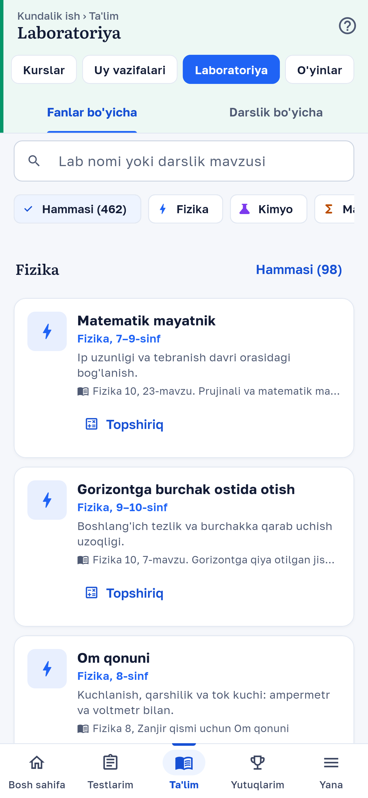 | 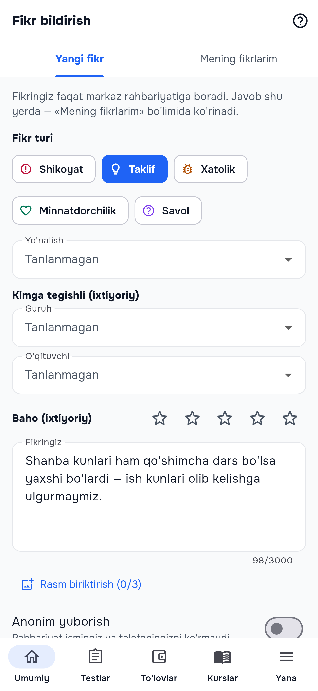 | 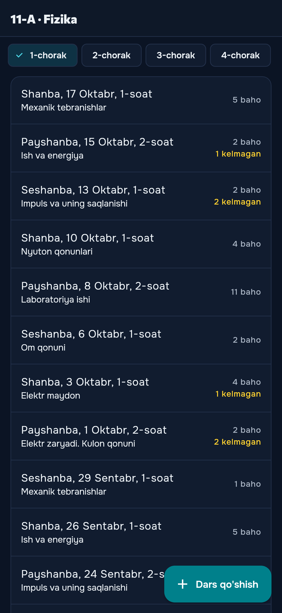 |

| | | | |
|---|---|---|---|
| 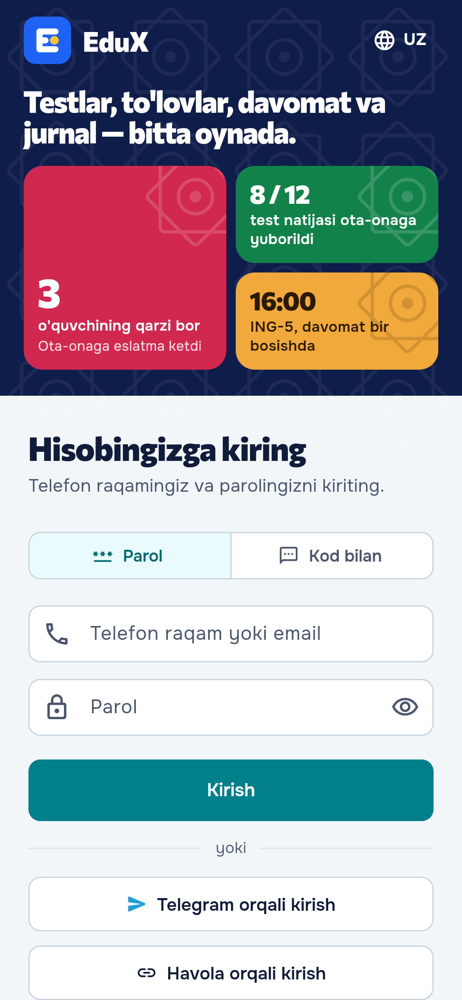 | 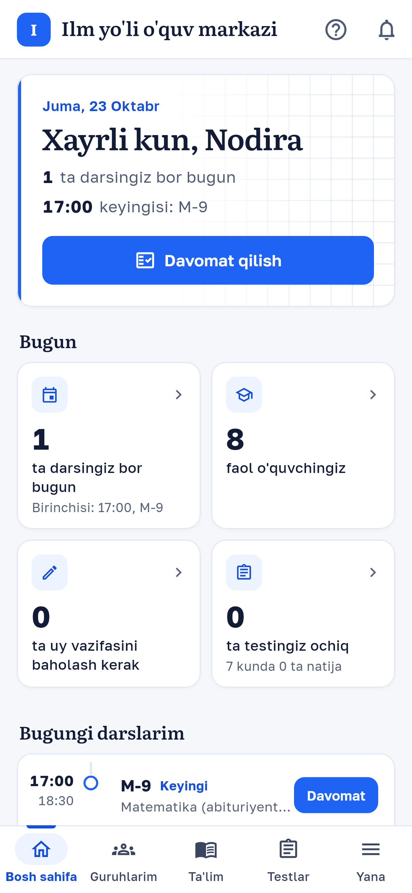 | 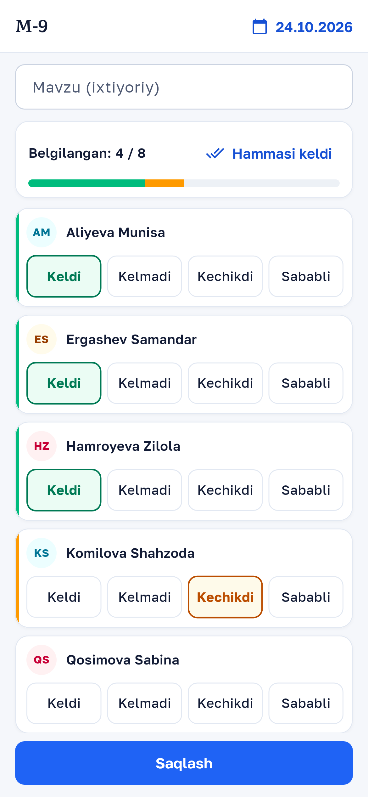 | 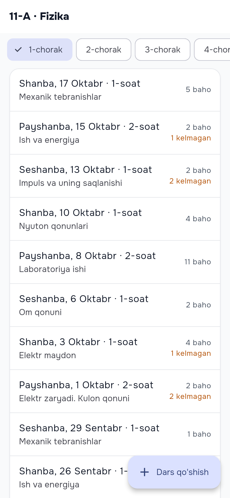 |
| 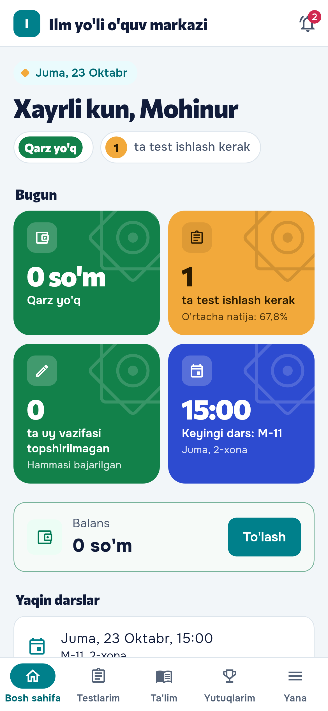 | 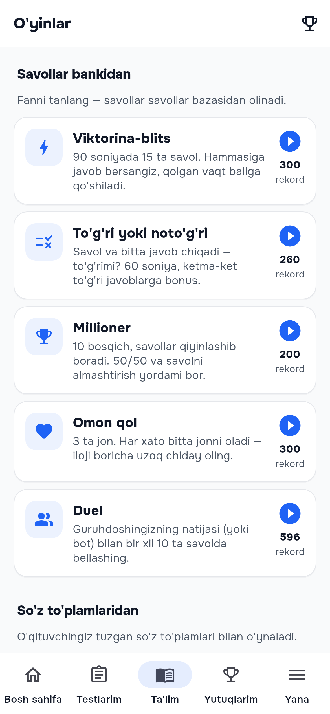 | 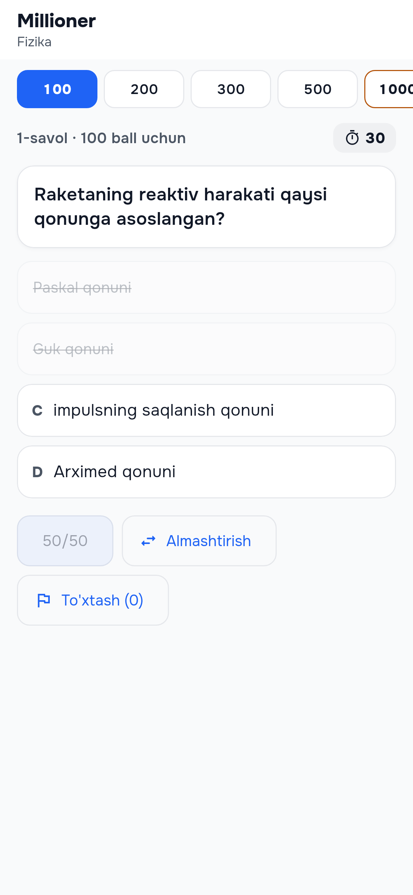 | 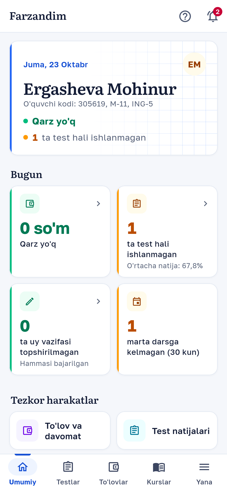 |

Hammasi `docs/screenshots/` da (390×844 @3x, 1170×2532 PNG; tungi rejim — `*-tungi.png`). Yangilash:
`screenshots/shots_test.dart` (demo ma'lumot `screenshots/fixtures/`, haqiqiy shriftlar) — commit xabarida `[skrinshot]`
bo'lsa yoki Actions → Screenshots → «Run workflow»; rasmlar `screenshots` branch'iga yoziladi
(`git fetch origin screenshots && git checkout FETCH_HEAD -- '*.png'`).

## 3.7 da yangi (iPhone va iPad; server 1.39: mijozlar fikri, 462 laboratoriya)

- **iPad** (`lib/core/adaptive.dart`): keng ekranda (oynaning qisqa tomoni ≥ 600 — iPad, Split View'da katta oyna) pastki
  menyu o'rniga **yon menyu** (NavigationRail; katta oynada yorliqlar bilan, 6 tagacha bo'lim, «Yana» belgisi); **ikki ustun**
  (ro'yxat + tafsilot, yangi sahifa ochilmaydi): O'quvchilar → karta, Davomat → varaqa, Jurnal → darslar, Moliya (to'lovlar
  va qarzdorlar) → o'quvchi kartasi, Murojaatlar → yozishma, Fikrlar → fikr kartasi; saqlanmagan davomat yoki yozilgan
  javob bo'lsa boshqa yozuv tanlanganda so'raladi. Kontent o'qish kengligida (~840; bosh sahifa, o'yinlar va lablar — 1180),
  to'rlar 2→4 ustun (bosh sahifa kartalari, tezkor harakatlar, ko'rsatkichlar), o'yinlar va lablar katalogi 1→3 ustun.
  Hamma yo'nalishlar, Split View / Slide Over (`UIRequiresFullScreen = false`), klaviatura (⌘1…⌘9 — menyu, Tab/Enter),
  sichqoncha/trackpad (hover). Burilganda yoki oyna o'lchami o'zgarganda tanlangan bo'lim va ro'yxat holati saqlanadi.
- **iOS sifati**: chetdan surib orqaga qaytish (jurnal baholari — o'zgarish bo'lmasa), Dynamic Type 0,85–1,6 oralig'ida,
  ishga tushish ekrani EduX rangida, iPad ikonkalari (`flutter_launcher_icons`), push uchun `aps-environment`
  (imzolanganda), ilova tillari (uz/ru/en). SMS shlyuz, bank SMS — faqat Android (iPhone'da menyuda yo'q, platforma egasiga
  «faqat Android ilovada» deb yoziladi).
- **Mijozlar fikri** (server 1.39, `docs/feedback.md`; `lib/core/feedback.dart`, `lib/features/feedback/`): «Yana → Fikr
  bildirish» — turi (shikoyat, taklif, xatolik, minnatdorchilik, savol), yo'nalishi, kimga tegishli (farzand, guruh,
  o'qituvchi), baho, rasm (3 tagacha), anonim; «Mening fikrlarim» — holat va markaz javobi. Rahbar (va sozlamadagi rollar):
  «Aloqa → Fikrlar» — holat bo'yicha filtr (soni bilan), muddati o'tganlar, turi, «Menga biriktirilgan», qidiruv; kartada
  muallif (anonimda yashirin), tarix, mas'ul, holat, muallifga javob («Hal qilindi» belgisi bilan) va ichki izoh.
  `GET context → feedback` bo'yicha ko'rinadi, menyuda «Yangi» fikrlar soni. Push `feedback` (panel) va `feedback_reply`
  (muallif) tegishli ekranni ochadi.
- **Laboratoriyalar (462 ta, 15 fan)**: «Fanlar bo'yicha» — fan → sinf guruhlari (guruhda 6 ta + «Yana»), qidiruv nom,
  tavsif va darslik mavzusi bo'yicha; «Darslik bo'yicha» — `GET fun/labs/topics?subject=` (darslik → bob → mavzu → lab);
  yangi fanlar (Tarix, Ona tili, Ingliz tili, Texnologiya, Chizmachilik, Iqtisodiyot, Musiqa, Tasviriy san'at) ikonka va
  ranglari; fan nomi serverdan foydalanuvchi tilida (`subject_label`).
- **Yig'ish**: CI `ios` job — `EduX-iOS-unsigned.ipa` (Payload/Runner.app; artefakt va `main` da Releases → latest),
  imzo kalitlari bo'lsa — App Store `.ipa` va TestFlight; `m139` (yoki commit xabarida `[ios]`) branch'ida ham ishlaydi.
- **Skrinshotlar**: `screenshots/devices_test.dart` — iPhone 6.7" va iPad 12.9", yorug' va tungi (`docs/screenshots/ios|ipad`).

## 3.6 da yangi (server 1.38: o'yinlar, to'lov havolasi, yangilanish)

- **16 ta o'yin, ilovada nativ** (`lib/core/games.dart`, `lib/features/fun/games/`): savollar bankidan — Viktorina-blits,
  To'g'ri yoki noto'g'ri, Millioner (50/50, almashtirish, to'xtash), Omon qol (3 jon), Duel (guruhdosh yoki bot);
  so'z to'plamlaridan — Juftini top, Xotira kartalari, So'z yig'ish, Dor, Krossvord, Tez yozish, Flesh-kartalar, Guruhlash;
  matematika — Matematik sprint, Ketma-ketlik, Sonlarni guruhlash. Protokol `v: 2`: har yurish `POST my/games/{id}/answer`
  da serverda tekshiriladi (javob kaliti ilovaga kelmaydi), vaqt server soatida; «Juftini top» va «So'z yig'ish» ham shu
  protokolga o'tdi. Katalog manba bo'yicha guruhlangan, manba (fan / to'plam / daraja) rekordlar bilan tanlanadi, manba
  yo'q bo'lsa sababi («So'z to'plami kerak — o'qituvchidan so'rang»). Natija: ball, to'g'ri/jami, vaqt, XP (kunlik chegara
  izohi bilan), rekord, tahlil (to'g'ri javoblar, qoida), reyting, «Yana o'ynash». Darsga biriktirilgan o'yin (`lesson_id`)
  dars ichidan ochiladi, tugagach dars o'tilgan deb belgilanadi. Telefon klaviaturasi, raqam paneli, jismoniy klaviatura (Dor),
  tungi rejim va 5 shablon, uz/ru/en. Testlar: `test/games_test.dart` (demo serverdan olingan haqiqiy javoblar
  `test/fixtures/games/`), `test/games_widget_test.dart` (har o'yin ekrani).
- **To'lov havolasi → «Kartaga o'tkazma»** (vebdagi `/p/<token>` kabi): karta raqami, noyob summa, muddat taymeri, holat
  kuzatuvi va «Yangi summa olish» — kirmasdan (`public/pay/{token}?order=`); to'lov usullari server tartibida, komissiya bilan.
- **Yangilanish tekshiruvi**: `GET public/apps` → `mobile.android.version` ilova versiyasidan yangi bo'lsa, kuniga bir marta
  «Yangi versiya» taklifi (Google Play yoki APK havolasi); «Yana» sahifasida «Ilova versiyasi» qatori — qo'lda tekshirish.
  Versiyani platforma egasi «Platforma → Sayt → Ilovalar» da kiritadi.
- **Veb sozlamalar yorliqlari** (`?tab=`): ilovada yo'q sozlamalarga «Brauzerda ochish» — kartaga o'tkazma
  (`/settings/payments?tab=p2p`), modullar, ta'lim sozlamalari (`lib/core/web_links.dart`).
- Laboratoriyalar ro'yxati serverdan (yangi lablar ilovani yangilamasdan chiqadi), yangi fanlar ikonkasi; topshiriqda faqat
  nomi ma'lum parametrlar.
- Davomat holatlari tor telefonda ham bitta qatorda; tugma matnlari ilova shriftida; ota-ona pastki menyusida qisqa nom.

## 3.5 da yangi (server 1.38: yordam markazi va qo'llab-quvvatlash)

- **«Yana» → «Yordam»**: yordam markazidan qidirish (`help/search`), «Ko'p beriladigan savollar» va «Muammolar va yechimlar»
  ilova ichida, «Murojaat yuborish», «Mening murojaatlarim», aloqa kanallari va ish vaqti. Brauzerda ochish ham qoldi.
- **Maqola ilova ichida** (`help/articles/{slug}`, kirmagan bo'lsa `public/help/...`): sarlavhalar, ro'yxatlar,
  «Eslatma/Diqqat» bloklari, rasmlar, jadvallar; boshqa maqolaga havola ilova ichida ochiladi; oxirida «Yordam berdimi?»
  (Ha / Yo'q → `feedback`), «Yo'q» bo'lsa — murojaat. HTML o'quvchi yangi paketsiz: `lib/core/help_html.dart`.
- **Har ekranda «?»** — o'z maqolasi (`lib/core/help_links.dart`, 20 slug; serverda borligi testda tekshiriladi):
  jurnal, kirish nazorati, kiosk, savol-javob va e'lonlar, dars, to'lovlarim, testlarim, kartaga o'tkazmalar, SMS shlyuz,
  murojaatlar, o'qituvchi bosh sahifasi. Kirish ekranida «Kira olmayapman?», xato/«aloqa yo'q» holatida «Muammolar va yechimlar».
- **Murojaat (server 1.38)**: rasm biriktirish (server cheklovi bo'yicha, 3 tagacha), ilova versiyasi, platforma
  (android/ios), OS va ekran o'lchami avtomatik `context` ga; yozishmada rasmlar, «Muammo hal bo'ldi» (yopish) va
  👍/👎 baho; javob haqidagi push (`type=support`) shu yozishmani ochadi. Eski server bilan ham ishlaydi.
- To'lov tizimlari: olimpiada badali, to'lov havolasi va obuna hisobida faqat Click/Payme emas — server bergan barcha
  tayyor tizimlar (Uzum Bank, Paynet, Oson, Alif Pay); to'lov usullari nomlari vebdagi bilan bir xil.

## 3.4.1 da yangi (audit: server 1.36 bilan to'liq moslik)

- **Maktab jurnali** (o'qituvchi — «Sinflarim → Jurnal», rahbar — «Ta'lim → Jurnal»): sinf + fan + chorak, darslar
  ro'yxati, har o'quvchiga baho (2–5) va davomat (qatnashdi / kechikdi / kelmadi / sababli), «Hammasi keldi», yangi dars
  (sana, soat, mavzu, uy vazifasi). Yozish huquqi server bo'yicha (`can_write`), saqlashda faqat o'zgargan kataklar yuboriladi.
- **«To'lovlarim»** (o'quvchi, CRM): balans, hisoblangan oylik to'lovlar, to'langanlar va «Onlayn to'lash».
- **CRMsiz kassir** (maktab + LMS): menyu bo'sh qolmaydi — «Kartaga o'tkazmalar»; «To'lov qabul qilish» chiqmaydi.
- **Tungi rejim va 5 shablon:** ma'no ranglari (yashil/sariq/qizil) rejimga qarab, asosiy rang kartada kamida 4.5:1,
  tugma matni o'qiladigan rangda — har rang × shablon × rejim `test/theme_contrast_test.dart` da tekshiriladi.
- **Xavfsizlik:** lab WebView faqat aynan shu serverda (origin), token WebView xotirasidan lab yopilganda va chiqishda
  o'chiriladi; kiosk WebView begona saytga o'tmaydi. Kamera/SMS ruxsati rad etilsa — «Sozlamalar» tugmasi.
- **Barqarorlik:** JSON'dagi qattiq `as` cast'lar xavfsiz o'qishga almashtirildi (`asRawList`, `asNumOrNull`);
  yashirin bo'limdagi call-markaz so'rovlari to'xtaydi; kartaga o'tkazma kuzatuvi ustma-ust so'rovsiz va muddatdan
  keyin siyraklashadi; asosiy ro'yxatlar (kurslar, vazifalar, testlar, natijalar, topshiriqlar) internetsiz ham ko'rinadi.
- **Server javoblari testlari:** `test/fixtures/*.json` — demo serverdan har rol bilan olingan haqiqiy javoblar;
  `test/api_fixtures_test.dart`, `test/school_journal_test.dart` ularni mobil parse mantiqiga beradi.

## 3.4 da yangi (server 1.35 / 1.36 bilan moslik)

- **Dizayn tizimi (veb 1.35 «Daftar», `docs/design.md`)**: 5 shablon — Klassik, Yumshoq, Qorong'i panel, Ixcham, Maktab
  (eski `vivid` → `school`, `midnight` → `night`), shrift (Onest, Manrope, Nunito — `assets/fonts`, OFL), shrift o'lchami
  va burchaklar. Ko'rinish uch qatlamdan: platforma standarti (`GET /site → theme`) → tashkilot brendi (`context.theme`) →
  shaxsiy (`user.appearance`, «Yana → Ko'rinish», `PUT profile/appearance`). Mantiq: `lib/core/design.dart`, `theme.dart`.
- **Bosh sahifalar** (direktor, o'qituvchi, kassir, marketolog, o'quvchi, ota-ona): «Bugun» kartalari (3–4 raqam, chap chetda
  ohang chizig'i) + katta tezkor harakatlar, keyin ro'yxatlar — `lib/core/home_today.dart`, `home_widgets.dart`.
- **Pastki navigatsiya** vebdagi `bottomNav()` bo'yicha: menyuning birinchi 4 bo'limi + «Yana»; bo'lim ichida yorliqlar;
  ota-onada «Farzandim» yorliqlari (Umumiy, Kundalik, Testlar, To'lov), «Kurslar» — «Yana»da. `lib/core/nav.dart`.
- **To'lovlar**: usullar server ro'yxati va tartibida (Click, Payme, Uzum, Paynet, Oson, Alif, komissiya, minimal summa);
  **kartaga o'tkazma (P2P)** — karta raqami va noyob summa (nusxalash), muddat taymeri, holatni so'rash, muvaffaqiyat
  ekrani; pullik kursni sotib olish/uzaytirish. Kassir: «Kartaga o'tkazmalar» (kutilayotgan, noma'lum kirimlar,
  tasdiqlash/biriktirish/rad etish, bank xabari matni).
- **SMS shlyuz**: platforma egasi hisobida `platform/sms/gateway/*` (push `scope=platform`); **bank SMS'larini serverga
  yuborish** (`RECEIVE_SMS`, jo'natuvchilar ro'yxati, internetsiz navbat, `enabled=false` — to'xtash, oxirgi yuborilganlar)
  — `lib/core/bank_sms.dart`, native `BankSmsReceiver` (`tool/configure_platforms.dart`); **«O'z telefonimdan»** (1.36)
  — kutilayotgan SMS'lar navbat rejimida, `sms:` havolasi bilan telefonning SMS ilovasi.
- **LMS**: dars bloklari konstruktor tartibida (matn, video, fayl, doska, test, uy vazifasi, interaktiv blok), virtual
  doskani ko'rish (CustomPainter, jonli rejimda 2,5 s, kattalashtirish), jonli dars kartasi («Darsga qo'shilish»), savol-javob,
  «tushundim» so'rovi, kurs e'lonlari; ota-onada «Kurslar»; o'qituvchiga — savollarga javob va e'lon yozish.
- **Laboratoriya**: 38 ta lab katalogi fan bo'yicha filtr bilan, interaktiv sahifa ilova ichidagi WebView'da.
- **Kirish nazorati**: Bluetooth / USB-OTG skaner (klaviatura rejimi, `lib/core/scan_keys.dart` — veb `scanner.js` mantiqi),
  kamerada QR bilan birga Code 128 shtrix-kod, qo'lda 6 xonali kod yoki 14 raqamli shtrix-kod.
- CI: `main` dan boshqa branch'larda faqat `flutter analyze` va `flutter test` (`check` job, relizsiz).

## 3.3 da yangi (server: yordam markazi)

- «Ko'proq» → «Yordam markazi»: veb-tizimdagi qo'llanmalar (`<server>/help`; brauzerda kirilmagan bo'lsa ochiq `/yordam`)
  tashqi brauzerda, ilova tilida (`?lang=`).
- Ekran sarlavhasidagi «?» — shu ekran maqolasi (`<server>/yordam/<slug>`): Skaner → `varaqani-skanerlash`,
  Davomat → `davomat-belgilash`, Testlar → `test-natijalari`, Farzandim → `farzandim`. Slug'lar: `lib/core/help_links.dart`.

## 3.2 da yangi (server 1.29 bilan moslik)

**Menyu va atamalar veb 1.29 bilan bir xil** (`docs/navigation.md`): bo'lim faqat rol, modul (`context.modules`),
qo'shimcha imkoniyat (`context.features`) va server yo'lining ruxsati bo'lsa ko'rinadi — 403 sahifasi o'rniga band umuman chiqmaydi.
Nomlar: O'quvchilar (tashkilot `terms` bo'yicha), Davomat, Testlar, Varaqalar, Topshiriqlar, Moliya, Yutuqlarim, Farzandim
(Umumiy · Kundalik · Testlar · To'lov va davomat), Mock natijalari, Sertifikatlar, Laboratoriya.

| Bo'lim | Kimga | Shart (server bilan bir xil) |
|---|---|---|
| O'quvchilar | direktor, administrator, o'qituvchi; kassir — CRM bilan | rahbar/kassir + CRM → `crm/students`; o'qituvchi yoki CRM siz → `students` (o'qituvchi `mine=1`), karta — `students/{id}/insights` |
| Bosh sahifa ko'rsatkichlari | direktor, administrator, o'qituvchi | `overview`, `crm/timetable?date=` (kassir va marketologda faqat bo'limlar) |
| Kirish nazorati, Kiosk | rahbar (kiosk), o'qituvchi (skaner) | `access` qo'shimchasi |
| SMS shlyuz | direktor, administrator (Android) | CRM + `sms` qo'shimchasi; obuna «faqat o'qish»da to'xtaydi |
| AI ustoz / AI yordamchi | o'quvchi / xodim | `ai` qo'shimchasi va `ai/status` (tashkilot sozlamasida yoqilgan) |
| Yutuqlarim | o'quvchi | `fun` (XP, nishonlar) yoki coin (CRM, `coins_enabled`) — bitta sahifada |
| O'yinlar, Laboratoriya | o'quvchi | `fun` |
| Modullar va obuna | direktor, administrator | ko'p tashkilotli rejim (`context.mode` ≠ `single`) |

**Modullar va obuna** (`GET billing`): holat va sanalar, limitlar (o'quvchi, xodim, filial, AI, SMS — sarf chizig'i),
modullar holati, qo'shimcha imkoniyatlar (qayerdan ochiq; faol davrda «Hozir qo'shish» → `POST billing/addons`), to'lanmagan
hisoblar (Click, Payme — tashqi sahifa, ilovaga qaytilganda holat yangilanadi; bank o'tkazmasi rekvizitlari), keyingi davr:
«Tayyor paket» yoki «Modullarni o'zim tanlayman», qo'shimchalar, to'lov davri (oylik, 3 oylik, 6 oylik, yillik — chegirma bilan)
→ `POST billing/quote` → `POST billing/invoices`. Obuna «faqat o'qish» bo'lsa, tepadagi sariq yozuv rahbarni shu sahifaga olib boradi;
platforma to'xtatgan obuna (`subscription.suspended`) uchun alohida matn.

**Push**: avval `data.route` (veb route nomi: my.payments, my.attempt, my.certificates, lms.my.assignments, child,
child.payments, child.diary, child.tests, public.certificate, crm.leads, crm.tasks; id lar `data.link` dan), eski serverda
`data.type` (payment, attendance, arrival, attempt, assignment, certificate, lead, task) yoki havola bo'yicha sahifa.
Ota-onaga `child.*` — «Farzandim»da shu farzand (`student_id`) va tegishli yorliq. Rol uchun yopiq sahifa ochilmaydi
(masalan, ota-onaga test natijasi — «Farzandim»da shu farzandning «Testlar» yorlig'i). Noma'lum xabar — bosh sahifa.

**Optimallashtirish**: pastki menyu tablari birinchi ochilganda quriladi (ilova ochilganda bir xil so'rovlar parallel ketmaydi);
«Farzandim» birinchi farzand holatini ikki marta so'ramaydi; o'quvchilar ro'yxati sahifalab (aylantirganda) yuklanadi;
internetsiz nusxalar versiyali (`OfflineCache.version`, `offline.context.v2`) — eski shakl o'qilmaydi; ilova fonda bo'lganda
Telegram orqali kirish va onlayn to'lov holati so'ralmaydi.

## 3.1 da yangi

**Xodimlar (bosh sahifadagi «Bo'limlar» va «Ko'proq» menyusi; modul, imkoniyat va rolga qarab ko'rinadi)**
- **Call markazi** (CRM + `callcenter`; direktor, administrator, marketolog, kassir): jonli kiruvchi qo'ng'iroq va qo'ng'iroq qiluvchi kartasi (o'quvchi/ota-ona, balans, guruhlar, lid, ochiq vazifalar, so'nggi qo'ng'iroqlar). Holat **faqat sahifa ochiq va ilova oldingi planda bo'lganda** har 10 soniyada so'raladi. Javobsiz qo'ng'iroqlar navbati («Hal qilindi», natija), natija belgilash (qayta qo'ng'iroq vaqti → vazifa, notanish raqam → lid), jurnal (bugun / 7 kun / shu oy), skriptlar, operator holati, raqam bo'yicha qidirish, qo'lda qayd. Tezkor amallar: qayta qo'ng'iroq (`tel:`), lid yoki o'quvchi kartasini ochish. Barcha so'rovlar `lib/features/callcenter/callcenter_repository.dart` da.
- **AI yordamchi** (`ai`): AI ustoz oynasi xodimlar uchun (`ai/status` → `staff`, `kind: staff`), suhbatlar tarixi va oylik limit.
- **Mavzular bo'yicha test** (Test moduli; direktor, administrator, o'qituvchi): fan → bo'lim → mavzu (savollar soni bilan), savollarni ko'rib chiqish (LaTeX), mavzular va har biridan nechta savol tanlanadi → qoralama test (`POST bank/topics/exam`). Test raqami va nomi ko'rsatiladi, veb-versiyada e'lon qilinadi.
- **Moliya** (CRM; direktor, administrator, kassir): bugungi to'lovlar (usullar bo'yicha), kassalar qoldig'i, qarzdorlar (qo'ng'iroq, SMS, Telegram/SMS eslatma, to'lov qabul qilish), joriy oy kunlari va oxirgi 12 oy bo'yicha tushum/xarajat. So'rovlar `lib/features/finance/finance_repository.dart` da.

**Sifat**
- **Internetsiz ko'rish**: bosh sahifa (xodim, o'quvchi), kundalik (joriy hafta), testlarim, «Farzandim» (farzandlar ro'yxati va Umumiy tab), o'quvchilar ro'yxati — oxirgi muvaffaqiyatli javob telefonda saqlanadi va internet bo'lmasa «Internet yo'q» belgisi bilan ko'rsatiladi; pastga tortib yangilash qayta urinadi. Ilova internetsiz ochilsa ham foydalanuvchi va tashkilot konteksti nusxadan tiklanadi. Chiqishda nusxalar o'chiriladi.
- **Bildirishnomalar markazi**: kelgan push xabarlar (ilova ochiq, fonda yoki yopiq bo'lganda ham) telefonda saqlanadi, o'qilgan/o'qilmagan, bosilganda tegishli sahifa ochiladi; bosh sahifada qo'ng'iroqcha va o'qilmaganlar soni.
- **Dizayn**: bir xil oraliqlar va kartalar, skelet yuklanish, yangilangan bo'sh/xato holatlari, kattaroq bosish maydonlari; tungi rejim va tashkilot rangi saqlanadi.
- **iPhone**: Info.plist ruxsat matnlari (kamera, galereya, mikrofon), push fon rejimi, minimal iOS 15.0 (Firebase); GitHub Actions'da imzosiz iOS yig'ish (`edux-ios-unsigned` artefakti) — Android yig'ilishiga ta'sir qilmaydi.

## 3.0 da yangi

**Kirish**
- Bir martalik kod bilan kirish: telefon raqamga kod Telegramga (hisob bog'langan bo'lsa) yoki SMS bilan keladi (`POST auth/code`, `auth/code/verify`).
- «Telegram orqali kirish»: bot ochiladi, «Start» bosilgach ilova o'zi kiradi (`POST auth/telegram-link`, `GET auth/telegram-link/{key}` — 2 soniyada bir so'rov, ilovaga qaytilganda darhol).
- Tugmalar server sozlamasiga qarab ko'rinadi (`GET auth/options`). Ota-ona hisobsiz ham **to'lov havolasi** (`/p/…`) bilan to'lay oladi.

**O'quvchi**
- **Olimpiadalarim**: havola (`…/o/…`) orqali qo'shilish, ro'yxatdan o'tish, badal to'lovi (Click/Payme), testni ilovadagi test oynasida ishlash, natija, o'rin va sertifikat, e'lonlar va reyting.
- **AI ustoz**: chat (formulalar LaTeX'da), suhbatlar tarixi, oylik limit. Test oynasi ochiq bo'lsa ustoz o'chadi (server ham tekshiradi).
- **O'yinlar**: viktorina-blits, «Juftini top», «So'z yig'ish» — rekord va reyting. **Yutuqlarim**: XP, daraja, ketma-ket kunlar, nishonlar, haftalik reyting.
- **Virtual laboratoriya**: tasodifiy qiymatli topshiriqlar, 3 ta urinish, XP.
- Onlayn to'lovdan keyin buyurtma holati kuzatiladi (`GET pay/orders/{id}`), balans o'zi yangilanadi.
- **Murojaatlar**: qo'llab-quvvatlashga yozish va yozishma (barcha rollar uchun).

**Ota-ona — «Farzandim»**
- Bir nechta farzand bo'lsa — tepada almashtirgich (tanlov eslab qolinadi).
- Tablar: **Umumiy** (balans va to'lash, davomat, so'nggi baholar va natijalar), **Kundalik** (maktab moduli), **Testlar**, **To'lov** (hisoblanmalar, to'lovlar, onlayn to'lov).
- Barcha so'rovlar `lib/features/guardian/guardian_repository.dart` da — endpointlar to'plami bitta joyda almashtiriladi.

**Tashkilot imkoniyatlari**
- `GET context` dagi `modules` va `features` (ai, olympiad, fun, …) bo'yicha menyu tuziladi: yoqilmagan bo'lim ko'rinmaydi.
- Server 403 qaytarsa, «Bu bo'lim hozircha mavjud emas» degan tushunarli oyna chiqadi.

## 2.0 da yangi

- Tungi, kunduzgi va «qurilmaga qarab» rejim; tashkilot tanlagan asosiy rang (veb bilan umumiy sozlama).
- Push-bildirishnomalar (Firebase): to'lov, davomat, test natijasi, baho, sertifikat, yangi lid, vazifa. Bosilganda kerakli sahifa ochiladi.
- Mock imtihonlar: bo'limlar o'z vaqti bilan, Listening audio (bir marta), Reading matni, ochiq javob va esse, IELTS band / daraja natijasi.
- O'quvchi: «Mock natijalarim» (o'sish), «Sertifikatlarim» (QR sahifa).
- Xodim (CRM): lidlar (holat, qo'ng'iroq, izoh, yangi lid) va vazifalar (bugun, muddati o'tgan, bajarildi).

## Imkoniyatlar

**O'qituvchi / administrator**
- Bosh sahifa: bugungi darslar, qisqa statistika, tezkor amallar.
- **Skaner** — javob varaqalarini kamera bilan tekshirish (pastda batafsil).
- Testlar: ro'yxat, natijalar reytingi, skanerni shu test uchun ochish.
- O'quvchilar: qidiruv, karta (balans, guruhlar, to'lovlar), to'lov qabul qilish.
- Davomat: guruh bo'yicha belgilash.
- Skanlar: telefon navbati, tekshiruv kutayotganlar (javoblarni qo'lda tuzatish, tasdiqlash yoki rad etish), serverdagi tarix.

**O'quvchi**
- Balans va onlayn to'lov, yaqin darslar, test natijalari, baholar, coinlar.
- Onlayn testlar (taymer, javoblar serverga darhol saqlanadi, natija va tahlil). Formulalar LaTeX'da ko'rsatiladi.
- Kurslar, darslar, materiallarni ochish; uy vazifasini matn yoki daftar surati bilan yuborish.
- Kundalik: haftalik jadval, mavzu, uy vazifasi, baho, davomat.

- Olimpiadalar, AI ustoz, o'yinlar, yutuqlar, virtual laboratoriya (tashkilotda yoqilgan bo'lsa), murojaatlar.

**Ota-ona**
- «Farzandim»: farzand almashtirgich; Umumiy, Kundalik, Testlar, To'lov tablari; onlayn to'lov.

## Skaner qanday ishlaydi

Varaqani o'qish telefonning o'zida, C++ dagi `packages/edux_omr` yadrosida bajariladi (Dart FFI, alohida isolate). Yadro serverdagi `omr-service` bilan aynan bir xil varaqa tuzilishi va chegaralardan foydalanadi.

1. Kamera oqimi ~9 kadr/s tahlil qilinadi: 4 ta ArUco burchak belgisi topiladi, varaqa ramkada ko'rsatiladi. Masofa, aniqlik, yorug'lik va qimirlash tekshiriladi, foydalanuvchiga maslahat chiqadi ("yaqinroq", "telefonni qimirlatmang" ...).
2. Varaqa 3 kadr davomida barqaror bo'lsa — avtomatik suratga olinadi (tugma bilan ham bo'ladi).
3. Perspektiva tekislanadi, yorug'lik notekisligi olib tashlanadi, QR (test, variant, o'quvchi kodi) va kataklar o'qiladi. ~0,2 s.
4. Test kaliti (`GET /scans/kit/{exam}`) telefonda saqlangan bo'lsa — ball va o'quvchi ismi **darhol, internetsiz** ko'rsatiladi; shubhali kataklar sariq rangda belgilanadi.
5. Rasm va telefon natijasi navbatga qo'yiladi va fonda serverga yuboriladi. Server o'zi ham qayta o'qiydi:
   - natijalar bir xil → avtomatik baholanadi;
   - farq bo'lsa → `device_mismatch` belgisi bilan "Tekshiruv"ga tushadi;
   - server o'qiy olmasa yoki ishlamasa → telefon natijasi saqlanadi va tekshiruvga yuboriladi.
6. Internet bo'lmasa navbat telefonda saqlanadi va aloqa tiklanganda o'zi yuboriladi.

Uzluksiz rejimda varaqani almashtirish kifoya — bir varaqa ikki marta olinmaydi. Galereyadan bir nechta rasmni birdaniga tekshirish ham mumkin.

**Sinov natijalari** (`packages/edux_omr/tool/test.sh`): 96 ta sun'iy varaqa (burilish, perspektiva, xiralik, soya, shovqin, JPEG) — telefon yadrosi natijalari server o'quvchisi bilan 96/96 bir xil, javoblar 100% to'g'ri; QR server o'qiy olmaydigan xiralikda ham o'qiladi.

## Yig'ish

Talablar: Flutter 3.35 yoki yangiroq, Android Studio (Android SDK + NDK), iPhone uchun macOS + Xcode 15+ va CocoaPods.

```bash
bash setup.sh          # android/ va ios/ papkalarini yaratadi, ruxsatlar va ikonkani sozlaydi
flutter run --dart-define=EDUX_SERVER=https://app.sizning-domen.uz
```

Windows'da `setup.sh` o'rniga:

```
flutter create --org uz.edux --project-name edux --platforms=android,ios .
del test\widget_test.dart
flutter pub get
dart run tool/configure_platforms.dart
dart run flutter_launcher_icons
```

`EDUX_SERVER` — ilova sukut bo'yicha ulanadigan server (berilmasa `https://edux.kuchkarov.uz`). Kirish oynasida server manzili ko'rinmaydi: o'z serveri bo'lgan tashkilot uchun logotipni uzoq bosish «Tizim manzili» oynasini ochadi. Standartdan farqli server tanlangan bo'lsa, kirish oynasi pastida uning manzili tugma sifatida ko'rinadi (bosilsa — o'sha oyna). Taklif havolasi bilan kirganda server havoladan olinadi.

### Android

```bash
flutter build apk --release --split-per-abi --dart-define=EDUX_SERVER=https://app.sizning-domen.uz
flutter build appbundle --release --dart-define=EDUX_SERVER=https://app.sizning-domen.uz   # Google Play uchun
```

Play Market uchun imzo: `keytool -genkey -v -keystore edux.jks -keyalg RSA -keysize 2048 -validity 10000 -alias edux`, so'ng `android/key.properties` va `android/app/build.gradle` dagi `signingConfigs` ni Flutter qo'llanmasi bo'yicha sozlang (https://docs.flutter.dev/deployment/android). Kalit faylini repozitoriyga qo'shmang.

### iPhone va iPad

```bash
cd ios && pod install && cd ..
open ios/Runner.xcworkspace     # Signing & Capabilities → Team, Bundle ID uz.edux.edux
flutter build ipa --release --dart-define=EDUX_SERVER=https://app.sizning-domen.uz
```

Tayyor `.ipa` ni Transporter yoki Xcode Organizer orqali App Store Connect / TestFlight'ga yuklang (yoki CI — yuqorida «iPhone va iPad: App Store'ga chiqarish»). Kamera, galereya va mikrofon ruxsat matnlari, push fon rejimi, iPad sozlamalari (hamma yo'nalishlar, Split View, trackpad, `TARGETED_DEVICE_FAMILY = "1,2"`), `aps-environment` (Release/Profile), ishga tushish ekrani va minimal iOS 15.0 `configure_platforms.dart` tomonidan qo'yiladi (Podfile `flutter build ios --config-only` dan keyin paydo bo'lsa, skriptni qayta ishga tushiring).

### GitHub Actions

`.github/workflows/build.yml`: boshqa branch'larda faqat tahlil va testlar (`check` job); `main` ga push'da testlarni ishga tushiradi, Android APK yig'adi (Artifacts bo'limida) va alohida `ios` job'ida (macos-latest) iOS'ni imzosiz yig'adi: `flutter build ios --release --no-codesign`, natija — `edux-ios-unsigned` artefaktidagi `EduX-iOS-unsigned.ipa` (`main` da Releases → latest ga ham). Imzo secrets'i bo'lsa — `flutter build ipa --export-options-plist` va TestFlight. iOS job `m139` branch'ida va commit xabarida `[ios]` bo'lsa ham ishlaydi; xato bersa ham Android yig'ilishi va Releases davom etadi. Server manzilini repozitoriy o'zgaruvchisi `EDUX_SERVER` orqali bering.

iOS'da push uchun Firebase'ning `GoogleService-Info.plist` matnini `GOOGLE_SERVICE_INFO_PLIST` secret'iga qo'ying (CI uni Runner'ga qo'shadi; «Push Notifications» — `Runner.entitlements`, «Remote notifications» — Info.plist). Imzosiz yig'ishda push o'chiq.

## Testlar

```bash
flutter test                              # Dart: baholash, formatlash
cd packages/edux_omr && bash tool/test.sh /yo'l/edux/omr-service 96   # C++ yadro ↔ server o'quvchisi
```

`test.sh` uchun g++ va Python 3 (`omr-service/requirements-dev.txt` dagi paketlar) kerak; birinchi argument — EduX server arxividagi `omr-service` papkasi.

## Server talablari

EduX server **1.8.0** yoki yangiroq: `device_result` maydoni va `GET /api/v1/scans/kit/{exam}` shu versiyada qo'shilgan. Eski serverda ilova ishlaydi, lekin telefon natijasi solishtirilmaydi va internetsiz baholash bo'lmaydi.

3.0 va 3.1 imkoniyatlari uchun server **1.28** tavsiya etiladi (call markazi — 1.25+, mavzulashtirilgan baza — 1.27+) (`context.features`). `features` qaytarmaydigan eski serverda qo'shimcha bo'limlar cheklanmagan deb hisoblanadi va mavjud bo'lmagan bo'lim ochilsa, 403/404 xabari ko'rsatiladi.

## Tuzilma

```
lib/
  core/              API, sessiya, tarjima, format, mavzu, umumiy vidjetlar, internetsiz nusxa, bildirishnomalar ombori
  features/
    auth/            kirish (parol, bir martalik kod, Telegram), tashkilot tanlash
    shell/           rolga, modul va imkoniyatlarga qarab pastki menyu
    scanner/         skaner, navbat, test kaliti, natija, tekshiruv
    staff/           bosh sahifa, o'quvchilar, to'lov, davomat, testlar
    callcenter/      call markazi va CallCenterRepository (barcha call-markaz so'rovlari)
    finance/         moliya (bugun, qarzdorlar, hisobot), FinanceRepository, kartaga o'tkazmalar (P2P)
    lms/             doska ko'rish, savol-javob va e'lonlar (o'qituvchi), farzand kurslari
    crm/             lidlar, topshiriqlar, «O'z telefonimdan» SMS navbati
    testing/         mavzular bo'yicha test (bank/topics)
    notifications/   bildirishnomalar markazi va qo'ng'iroqcha
    student/         bosh sahifa, onlayn testlar, kurslar, uy vazifasi, kundalik, to'lov, to'lov havolasi
    guardian/        «Farzandim» va GuardianRepository (ota-onaning barcha so'rovlari)
    olympiad/        olimpiadalarim, olimpiada sahifasi
    tutor/           AI ustoz
    fun/             o'yinlar, yutuqlar, virtual laboratoriya
    support/         murojaatlar
    settings/        til, skaner sozlamalari, chiqish
packages/edux_omr/   C++ OMR yadrosi (quirc — ISC, stb — public domain) va Dart FFI
assets/i18n/         ru.json, en.json (kalit — o'zbekcha matn)
tool/                platforma sozlash, tarjima tekshiruvi
```

## Cheklovlar

- Olimpiadalar ro'yxati: serverda o'quvchi uchun «mening olimpiadalarim» endpointi yo'q — ochilgan/ro'yxatdan o'tilgan olimpiada havolalari telefonda saqlanadi. `/o/…`, `/p/…` havolalarini ilovaga to'g'ridan-to'g'ri ochish (App Links / Universal Links) hali sozlanmagan: havola nusxalanib ilovaga qo'yiladi.
- Virtual laboratoriyaning interaktiv tajribasi veb sahifasi (WebView) orqali ochiladi; ilovaning o'zida — topshiriq matni, qiymatlar va javob.
- Bank SMS'lari ilova yopiq bo'lsa ham telefonda yig'iladi, lekin serverga ilova ochilganda (yoki fonda ishlab turganda) yuboriladi.
- Doskani chizish — faqat vebda (ilovada ko'rish).
- Tashqi (boshqa markazdagi) ishtirokchi olimpiada testini brauzerdagi shaxsiy havola orqali ishlaydi.

- Push-bildirishnomalar Firebase sozlangan yig'ilishdagina ishlaydi (`GOOGLE_SERVICES_JSON`; iOS'da `GoogleService-Info.plist` va imzo). Bildirishnomalar markazi faqat shu telefonga kelgan xabarlarni ko'rsatadi — serverda xabarlar tarixi endpointi yo'q; ilova o'chirilsa yoki chiqilsa ro'yxat tozalanadi.
- Call markazi: jonli holat so'rov orqali (10 s) — real vaqt (WebSocket) yo'q; qo'ng'iroq yozuvini tinglash va matnga o'girish, statistika, skript/ovozli operator sozlamalari vebda. Marketolog o'quvchi kartasini ocha olmaydi (server ruxsati).
- Moliya: to'lovni bekor qilish, qaytarish, xarajat va kassa o'tkazmalari, eksport — vebda. Bugungi ro'yxatda birinchi 50 ta to'lov.
- Mavzular bo'yicha test: faqat qoralama yaratiladi (guruh, e'lon qilish, variantlar — vebda); filtrlar (qiyinlik, yil) ilovada yo'q, til tanlash bor.
- Internetsiz nusxa faqat ko'rish uchun: o'zgartirish (to'lov, davomat, test) internet talab qiladi.
- Faqat HTTPS serverlar: Android/iOS sukut bo'yicha shifrlanmagan HTTP'ni bloklaydi. Mahalliy sinov uchun `http://` kerak bo'lsa, AndroidManifest'ga `android:usesCleartextTraffic="true"` qo'shing.
- Ilova yozilgan muhitda Flutter SDK yo'q edi: C++ yadro to'liq sinovdan o'tgan, Dart kodi sintaksis bo'yicha tekshirilgan, lekin birinchi `flutter analyze` / `flutter run` ni ishlab chiquvchi kompyuterida bajarish kerak.
